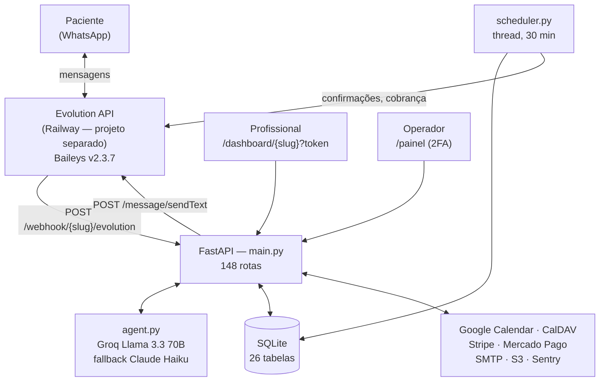
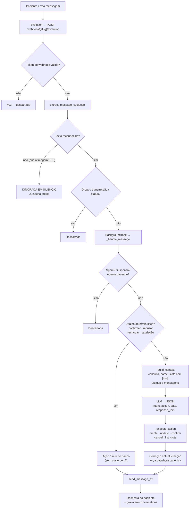

# 02 — Arquitetura Técnica

> Evidências: `Dockerfile`, `backend/*.py`, `backend/requirements.txt`.

---

## 1. Estrutura de diretórios

```
whatsapp-agent/
├── Dockerfile                    # carimbo de build na linha 2
└── backend/
    ├── requirements.txt
    ├── main.py                   4.600 linhas — rotas, webhooks, páginas, APIs
    ├── database.py               2.773 — schema, migrações e TODAS as queries
    ├── agent.py                  1.743 — IA, prompts, ações
    ├── scheduler.py                779 — tarefas periódicas
    ├── contract_service.py         616 — contrato + PDF
    ├── whatsapp_service.py         580 — envio/recebimento por provedor
    ├── insights_service.py         426 — Home Inteligente
    ├── evolution_provisioning.py   376 — provisionamento Evolution
    ├── stripe_service.py           313
    ├── email_service.py            305
    ├── billing_reminders.py        282
    ├── instance_monitor.py         247
    ├── landing_content.py          201
    ├── caldav_service.py           193
    ├── mp_service.py               188 — Mercado Pago
    ├── segments.py                 175
    ├── calendar_service.py         161 — slots e formatação
    ├── backup_service.py           151
    ├── google_calendar_service.py  141
    ├── config.py                    93
    ├── crypto.py                    86 — Fernet
    ├── seed.py / tenant_service.py / set_free_access.py / events.py / models.py
    ├── templates/                 15 arquivos HTML (408 KB)
    └── static/                    imagens, PDFs e protótipos
```

**Total: 14.724 linhas de Python em 26 módulos.**

### Observação estrutural crítica
`main.py` concentra **148 rotas em 4.600 linhas** e `database.py` **2.773 linhas** de
acesso a dados. Não há camada de serviço entre rota e banco, nem separação por domínio.
Isso é o principal fator de risco de regressão: cada alteração exige navegar arquivos
enormes, e não há teste que proteja.

Distribuição das rotas:

| Prefixo | Rotas |
|---|---|
| `/dashboard/*` | 62 |
| `/painel/*` | 29 |
| `/admin/*` | 16 |
| `/controle/*` | 8 |
| `/onboarding/*` | 6 |
| `/master/*` | 6 |
| `/webhook(s)/*` | 6 |
| `/contrato/*` | 4 |
| demais (público, checkout, google, healthz) | 11 |

---

## 2. Stack

| Camada | Tecnologia |
|---|---|
| Linguagem | Python 3.11 |
| Framework | FastAPI 0.115 + Uvicorn 0.30 |
| Templates | Jinja2 3.1 (renderização no servidor) |
| Frontend | HTML + Tailwind via CDN + JavaScript inline. **Não há build nem framework** |
| Banco | SQLite (`sqlite3` nativo) |
| IA | `anthropic` 0.40, `groq` 0.11 |
| WhatsApp | HTTP (`httpx`) para Evolution/Z-API; `twilio` 9.3 |
| Pagamentos | `stripe` 10.5; Mercado Pago via HTTP |
| Agenda | `google-api-python-client`, CalDAV via HTTP |
| PDF | `reportlab` 4.2 |
| Observabilidade | `sentry-sdk[fastapi]` |
| Backup | `boto3` (S3/R2/B2) |
| Criptografia | `cryptography` (Fernet) |

**Ponto de atenção:** `dashboard.html` tem **201 KB** com JavaScript inline. Não há
bundler, lint ou teste de frontend; a validação possível é apenas sintática.

---

## 3. Banco de dados

**SQLite**, arquivo em `DATA_DIR` (volume da Railway). `database.py:init_db()` cria o
schema e aplica **45 migrações incrementais** idempotentes (`ALTER TABLE`).

### Tabelas (26)

**Núcleo:** `tenants`, `appointments`, `conversations`, `patients`, `agent_paused`
**Cobrança:** `billing_logs`, `billing_overrides`, `billing_manual_entries`,
`billing_payments`, `billing_receipts`
**Contrato:** `contract_templates`, `contracts`, `contract_settings`,
`contract_reminders_log`, `contract_new_patient_exempt`
**Operação:** `op_bills`, `bill_reminders_log`, `instance_health`, `cancellation_log`
**Admin/segurança:** `admin_users`, `admin_sessions`, `login_attempts`, `audit_log`,
`webhook_seen`
**Site:** `landing_views`, `site_content`

### Relacionamentos
Quase tudo se liga a `tenants.id` por `tenant_id`. **Apenas `appointments` e
`conversations` declaram `REFERENCES tenants(id)`**; as demais tabelas usam `tenant_id`
sem chave estrangeira. Integridade referencial é responsabilidade do código.

### Riscos do modelo de dados
1. **Sem índice único em `appointments`** → dupla reserva possível (ver `08`).
2. **SQLite com escrita concorrente** — adequado ao volume atual, mas é um teto de
   escala. Com vários consultórios ativos simultaneamente, `database is locked` passa a
   ser um risco real. **NÃO VERIFICADO:** se `WAL` está habilitado.
3. **Migrações sem versionamento** — uma lista de `ALTER TABLE` aplicada no boot. Não há
   rollback nem registro de qual migração rodou.

---

## 4. Inteligência artificial

`agent.py:_call_llm` (linha 43):

1. **Primário:** Groq `llama-3.3-70b-versatile`
2. **Fallback:** Anthropic `claude-haiku-4-5` (quando Groq falha)
3. **Visão:** `claude-haiku-4-5` em `classify_image` (linha 88)

> **Observação comercial relevante:** o cérebro padrão do produto é um **Llama via Groq**,
> não Claude. A escolha privilegia custo e latência. A qualidade de aderência a instruções
> longas (os prompts têm ~19.700 caracteres) é menor que a de modelos maiores — o que é
> coerente com os erros de agendamento observados. **NÃO VERIFICADO:** comparação empírica
> de qualidade entre os dois.

Parâmetros: `max_tokens=512` nas chamadas de conversa.

---

## 5. Integração com WhatsApp

Três provedores (`whatsapp_service.py`), escolhidos por `tenants.whatsapp_provider`:

| Provedor | Envio | Recebimento | Mídia |
|---|---|---|---|
| **Evolution** (produção) | `_send_evolution_ex` (linha 102) | `extract_message_evolution` (143) | ❌ **só texto** |
| **Z-API** | `_send_zapi_ex` (186) | `extract_message_zapi` (386) | ✅ imagem, documento, PIX |
| **Twilio** | `_send_twilio` (538) | `extract_message_twilio` (546) | NÃO VERIFICADO |
| `mock` | log apenas | — | — |

**Assimetria crítica:** o provedor em produção é o que tem **menos** capacidade. Mensagens
de mídia são descartadas silenciosamente porque o extractor devolve `None`.

As três colunas `evolution_url`, `evolution_instance` e `evolution_key` são
**compartilhadas** entre Evolution e Z-API, com significados diferentes em cada um. Isso
já causou um incidente em produção (salvar o card Z-API trocava o provedor e derrubava o
envio) — corrigido na build 57, mas o acoplamento permanece.

---

## 6. Webhooks e integrações externas

**Entrada:** `/webhook/{slug}/evolution`, `/webhook/{slug}/zapi`, `/webhook/{slug}/zapi/sent`,
`/webhook/{slug}/twilio`, `/webhooks/stripe`, `/webhooks/mercadopago`

**Saída:** Evolution/Z-API/Twilio, Google Calendar, CalDAV, Stripe, Mercado Pago, SMTP,
S3/R2/B2, Sentry, Groq, Anthropic

**Segurança do webhook de mensagens:** token por tenant (`tenants.webhook_token`),
validado em `_validate_webhook_token` via query string, `X-Webhook-Token` ou `Client-Token`.
**Tenants antigos sem token são aceitos** (modo legado com warning) — brecha a fechar.

**Deduplicação:** tabela `webhook_seen` (persistente, sobrevive a restart).

---

## 7. Tarefas agendadas

`scheduler.py` — **thread daemon**, laço a cada 30 minutos. Janela de envio 7h–22h.

| Job | Quando | O que faz |
|---|---|---|
| `_run_confirmations` | 7h–22h | Confirmação ~24h antes + follow-up no dia |
| `_run_billing` | dia definido, 20h | Cobrança mensal por paciente |
| `_run_backup` | 3h | Backup para S3/R2/B2 |
| `_run_billing_reminders` | 9h (configurável) | Vencimento de contas e da instância |
| `_run_contract_reminders` | 7h–22h | Lembrete e expiração de contrato |

**Limitação arquitetural:** o agendador roda **dentro do processo web**, como thread. Com
mais de uma réplica, os jobs rodariam em duplicata. Hoje há 1 réplica, então funciona —
mas **escalar horizontalmente quebra o sistema**. Não há fila (Celery/RQ/Arq); o
processamento de mensagem usa `BackgroundTasks` do FastAPI, que se perde se o processo
morrer no meio.

---

## 8. Hospedagem e deploy

- **App:** Railway, projeto "Agente de Atendimento" (Postgres + serviço do app com volume).
  Imagem construída do `Dockerfile`. **1 réplica**, região US West.
- **Evolution API:** Railway, **projeto separado**, serviço `evolution-api`, imagem
  `evoapicloud/evolution-api:latest`, 1 réplica. Roda **v2.3.7**.
- **Deploy:** `git push origin main` → build automático. Confirmação por `/healthz`
  (`instance_start` derivado de `ts` − `uptime_s`).

### Riscos de infraestrutura

1. 🔴 **Imagem `latest` na Evolution.** Quando a 2.4.0 virar estável, qualquer redeploy —
   inclusive o disparado ao salvar uma variável — puxa uma versão que **exige licença** e
   responde `503` em todas as chamadas. Indisponibilidade total do produto.
2. 🟠 **Domínio raiz sem certificado.** `agenteconsultorio.com.br` resolve para um IP da
   Railway mas apresenta certificado `*.up.railway.app` → falha de TLS. Só `www` funciona.
   Isso já quebrou webhooks e afeta links de contrato enviados a pacientes.
3. 🟠 **Agendador acoplado ao processo web** — impede escalar.
4. 🟡 **SQLite em volume** — sem réplica de leitura, sem failover.

---

## 9. Autenticação, autorização e isolamento

| Superfície | Mecanismo | Avaliação |
|---|---|---|
| `/dashboard/*` | `dashboard_token` na URL + `X-Dashboard-Token` | 🟡 Funciona e isola, mas token em URL vaza por histórico/compartilhamento e **não expira** |
| `/controle/{token}` | token próprio na URL | 🟡 Idem |
| `/contrato/{token}` | token por contrato | 🟢 Adequado (link público por natureza) |
| `/painel/*` | usuário + senha (hash+salt) + **2FA TOTP** + lockout + sessão com expiração | 🟢 Bom |
| `/admin/*`, `/test/*` | **MASTER_KEY** obrigatória, fail-closed | 🟢 Bom |
| `/master/*` | NÃO VERIFICADO | — |
| Webhooks | token por tenant; **legado aceito sem token** | 🟠 Brecha |

**Isolamento entre clientes:** `_get_tenant_by_token` resolve o tenant pelo token e todas
as queries recebem `tenant_id`. Não encontrei endpoint do dashboard que aceite `tenant_id`
do cliente — o tenant vem sempre do token. **Avaliação: isolamento correto por desenho**,
porém **NÃO VERIFICADO por teste** (não há testes).

---

## 10. Logs, monitoramento e erros

- **Logs:** `logging` padrão para stdout (capturado pela Railway).
- **Sentry:** ativo (`sentry: true` em `/healthz`).
- **Health:** `/healthz` com `db`, `db_ms`, `uptime_s`, `rss_mb`, `tenants_count`.
- **Diagnóstico por cliente:** `/dashboard/api/whatsapp/diagnose` — provider, conexão,
  instância (número pareado mascarado, última desconexão traduzida), webhook gravado no
  provedor e último webhook recebido.
- **Monitor de instância:** `instance_monitor.py` checa saúde e grava em `instance_health`.

### Lacunas
1. **Nenhum alerta proativo ao operador** quando um cliente para de funcionar. Incidente
   verificado: 7 dias sem atendimento, descoberto por acaso.
2. **Sem métricas de negócio** (mensagens/dia, custo de IA, latência).
3. **Falhas silenciosas**: durante a auditoria foram encontrados dois casos em que o
   retorno de erro era descartado (`set_webhook` e o fallback de envio) — ambos corrigidos
   nas builds 60 e 65, mas o padrão sugere que existam outros.

---

## 11. Diagrama — arquitetura



## 12. Diagrama — ciclo de vida de uma mensagem


