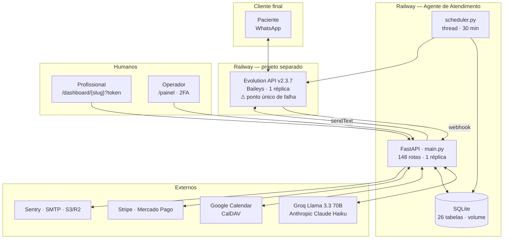
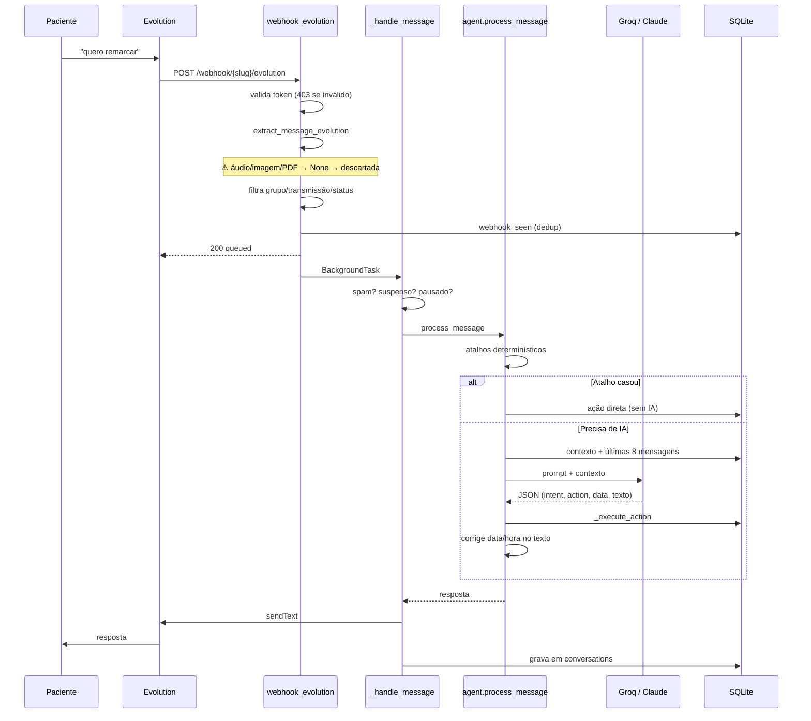
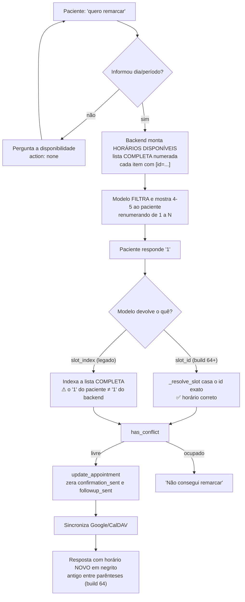
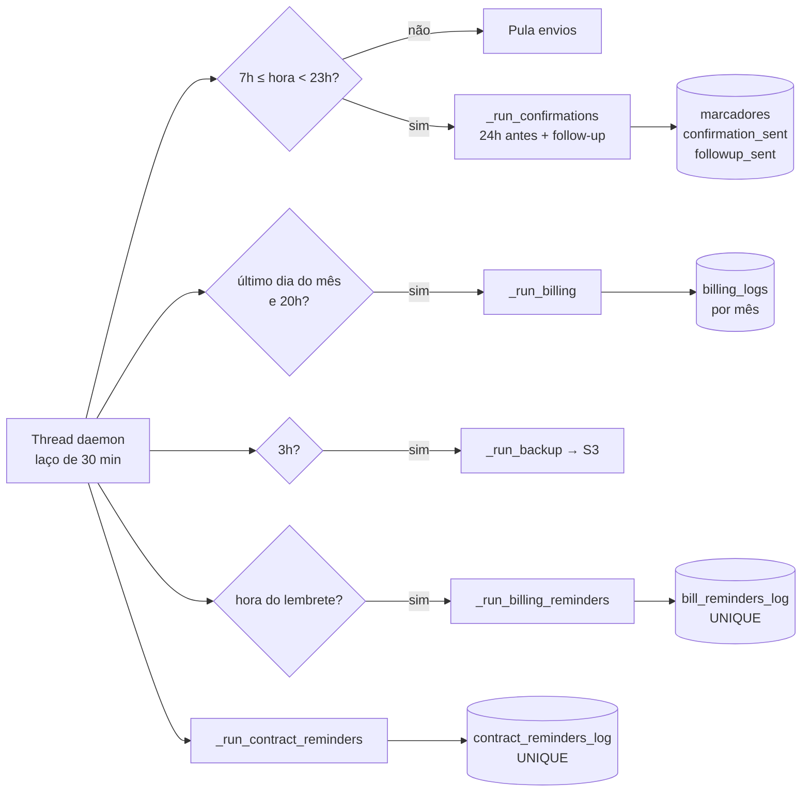
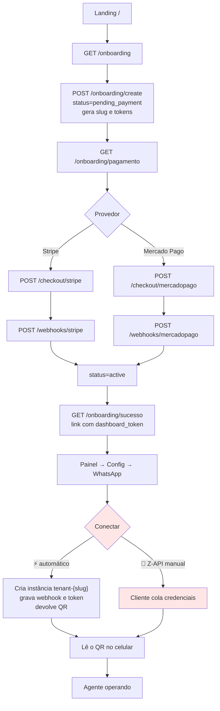
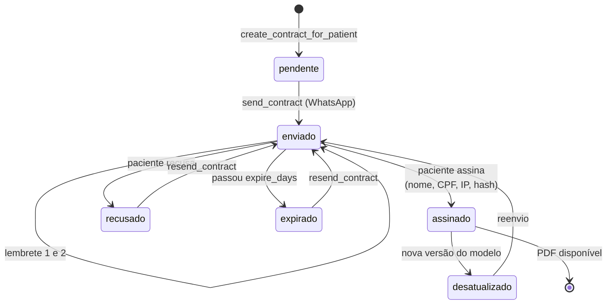
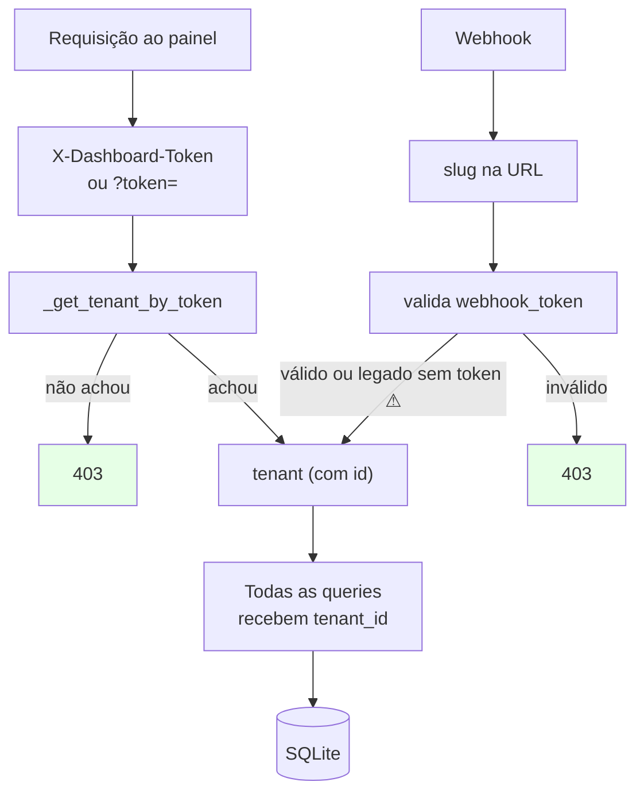
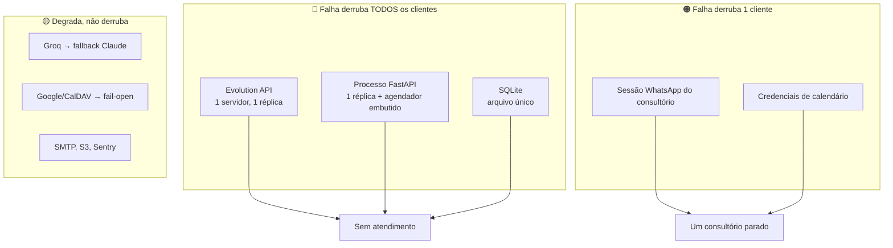

# 12 — Fluxos e Diagramas

> Diagramas em Mermaid. Todos derivados da leitura do código, com os arquivos e funções
> indicados.

---

## 1. Arquitetura geral

---

## 2. Ciclo de vida de uma mensagem recebida

---

## 3. Agendamento e remarcação (onde esteve o defeito da build 64)

**Nota:** antes da build 64 o prompt mandava usar *"o número exato do display"*, enquanto o
backend indexava a lista completa — contradição direta que marcava o paciente em outro
horário. Hoje o `slot_id` resolve e o índice é só reserva.

---

## 4. Automações do agendador

Idempotência: cada job verifica o estado no banco antes de enviar — reiniciar o processo
não duplica mensagem.

---

## 5. Onboarding de um novo cliente

🔴 Em vermelho o ponto de maior atrito: dois caminhos concorrentes, com botões quase
idênticos, compartilhando as mesmas três colunas do banco.

---

## 6. Contrato — ciclo completo

---

## 7. Isolamento entre clientes

O cliente **nunca** informa `tenant_id`; ele é sempre derivado do token. Desenho correto —
porém **sem nenhum teste** que comprove.

---

## 8. Pontos únicos de falha

O incidente de setembro é o caso **A**: o processo da Evolution travou e o único cliente
em operação ficou 7 dias sem atendimento, **sem nenhum alerta**.
